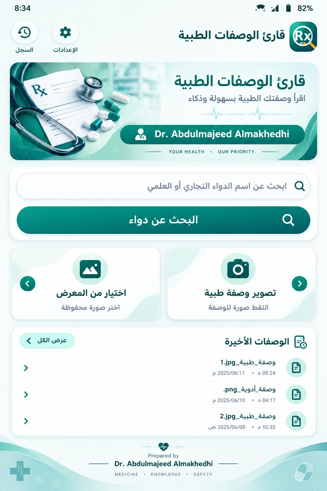
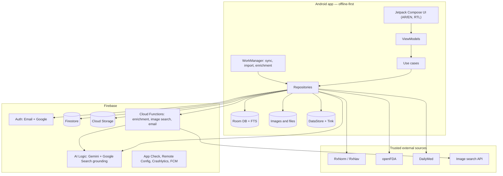
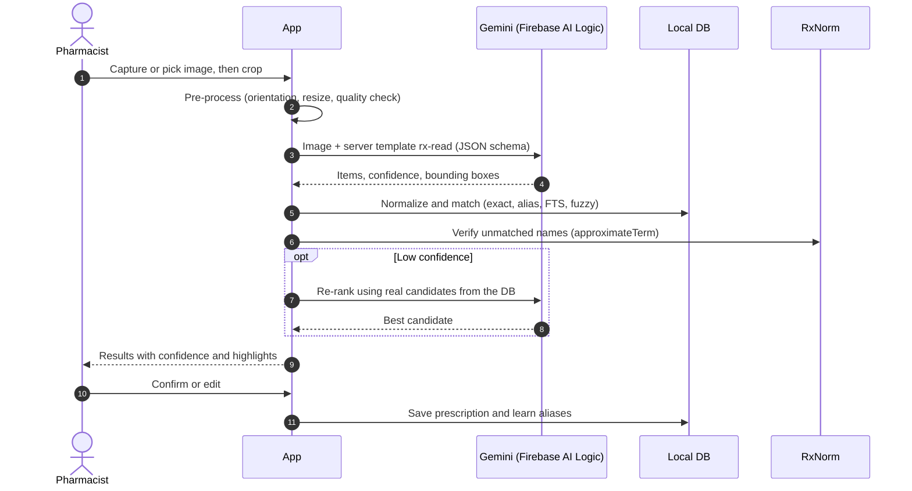
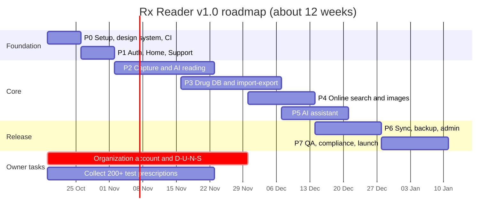

# خطة بناء تطبيق «قارئ الوصفات الطبية» — Rx Reader

<p align="center">
  
</p>

> **إعداد: د. عبدالمجيد الماخذي — Prepared by Dr. Abdulmajeed Almakhedhi**
> نسخة الخطة: 1.0 · التاريخ: أكتوبر 2026 · المنصة: Android
> «Your Health • Our Priority» · «Medicine • Knowledge • Safety»

---

## الفهرس

1. [الملخص التنفيذي](#1-الملخص-التنفيذي)
2. [ماذا يعني «تطبيق حقيقي» وليس نسخة تجريبية؟](#2-ماذا-يعني-تطبيق-حقيقي-وليس-نسخة-تجريبية)
3. [الرؤية والجمهور والهوية](#3-الرؤية-والجمهور-والهوية)
4. [المزايا بالتفصيل وأولوياتها](#4-المزايا-بالتفصيل-وأولوياتها)
5. [التقنيات المقترحة](#5-التقنيات-المقترحة)
6. [البنية المعمارية](#6-البنية-المعمارية)
7. [محرك قراءة الوصفة بالذكاء الاصطناعي](#7-محرك-قراءة-الوصفة-بالذكاء-الاصطناعي)
8. [قاعدة بيانات الأدوية](#8-قاعدة-بيانات-الأدوية)
9. [الاستيراد والتصدير (CSV / Excel / JSON)](#9-الاستيراد-والتصدير-csv--excel--json)
10. [البحث عن صور ومعلومات المنتج وحفظها تلقائياً](#10-البحث-عن-صور-ومعلومات-المنتج-وحفظها-تلقائياً)
11. [المساعد الدوائي الذكي والمصادر الموثوقة](#11-المساعد-الدوائي-الذكي-والمصادر-الموثوقة)
12. [الحسابات والمزامنة والنسخ الاحتياطي](#12-الحسابات-والمزامنة-والنسخ-الاحتياطي)
13. [الدعم الفني والتواصل مع د. عبدالمجيد](#13-الدعم-الفني-والتواصل-مع-د-عبدالمجيد)
14. [تصميم الواجهة ونظام التصميم](#14-تصميم-الواجهة-ونظام-التصميم)
15. [الأمان والخصوصية والامتثال](#15-الأمان-والخصوصية-والامتثال)
16. [الجودة والاختبار وقياس دقة الذكاء الاصطناعي](#16-الجودة-والاختبار-وقياس-دقة-الذكاء-الاصطناعي)
17. [التطوير والنشر الآلي (DevOps)](#17-التطوير-والنشر-الآلي-devops)
18. [مراحل التنفيذ والجدول الزمني](#18-مراحل-التنفيذ-والجدول-الزمني)
19. [التكاليف التقديرية](#19-التكاليف-التقديرية)
20. [المخاطر وخطط التخفيف](#20-المخاطر-وخطط-التخفيف)
21. [المطلوب منك وقرارات تحتاج تأكيدك](#21-المطلوب-منك-وقرارات-تحتاج-تأكيدك)
22. [الخطوات التالية](#22-الخطوات-التالية)
23. [الملاحق](#23-الملاحق)

---

## 1. الملخص التنفيذي

نبني تطبيق Android أصلياً (Native) بمستوى إنتاجي يقرأ الوصفات الطبية المكتوبة بخط اليد باستخدام الذكاء الاصطناعي، ويستخرج كل دواء بالاسم التجاري والاسم العلمي مع التركيز والشكل الصيدلاني والجرعة والتكرار والمدة ونسبة الثقة. بعدها يطابق النتائج مع قاعدة بيانات أدوية محفوظة بشكل دائم على الجهاز، يمكن استيرادها وتصديرها بصيغ CSV وExcel وJSON وتعديل أصنافها أو حذفها. كما يبحث عن الدواء في قوقل وفي المصادر الطبية الرسمية، ويوفّر مساعداً دوائياً ذكياً يذكر مصدر كل إجابة.

| البند | القرار المقترح |
|---|---|
| المنصة | Android ‏8.0 فما فوق (minSdk 26) · ‏targetSdk 36 ‏(Android 16) |
| لغة البرمجة والواجهة | Kotlin + Jetpack Compose + Material Design 3 |
| الذكاء الاصطناعي | Google Gemini عبر Firebase AI Logic + البحث المؤرَّض في قوقل (Grounding with Google Search) |
| الخادم السحابي | Firebase: ‏Auth · Firestore · Storage · Cloud Functions · App Check · Crashlytics · Remote Config · FCM |
| التخزين المحلي | Room ‏(SQLite) + بحث نصي كامل FTS — يعمل دون إنترنت (Offline-first) |
| اللغات | العربية (افتراضية) والإنجليزية مع دعم كامل للاتجاه من اليمين لليسار RTL |
| تسجيل الدخول | البريد الإلكتروني وكلمة المرور + حساب Google |
| الدعم الفني | واتساب ‎+967 781 733 795 · البريد 7a8b1d@gmail.com |
| المدة التقديرية | نحو 12 أسبوعاً حتى الإصدار 1.0 على Google Play، عبر 8 مراحل (من 0 إلى 7) |

### ⚠️ أربع حقائق مهمة يجب معرفتها من الآن

1. **حساب مطوّر من نوع «منظمة» في Google Play:** تشترط سياسة Google Play أن تُنشر التطبيقات الصحية والطبية من حساب مطوّر من نوع **Organization** مع رقم **D-U-N-S**. يجب البدء بهذه الإجراءات مبكراً لأنها قد تستغرق أسابيع.
2. **Gemini متاح رسمياً في اليمن،** لكن يجب العمل على **الباقة المدفوعة**، لأن Google تستخدم بيانات الباقة المجانية لتحسين منتجاتها، وهذا غير مقبول مع صور وصفات المرضى.
3. **Firebase App Check إلزامي** لاستخدام Firebase AI Logic ابتداءً من 2 نوفمبر 2026، وهو مدمج في الخطة من اليوم الأول.
4. **واجهة Google Custom Search JSON API** مغلقة أمام العملاء الجدد وتتوقف نهائياً في 1 يناير 2027. لذلك لن نعتمد عليها، ونستخدم بدلاً منها Gemini المؤرَّض ببحث قوقل، والمصادر الرسمية، وواجهات بديلة للبحث عن الصور.

---

## 2. ماذا يعني «تطبيق حقيقي» وليس نسخة تجريبية؟

| المعيار | ما سنلتزم به |
|---|---|
| خوادم حقيقية | Firebase بإعدادات إنتاج (مشروعان منفصلان dev وprod)، ولا توجد بيانات وهمية داخل الكود |
| ذكاء اصطناعي حقيقي | استدعاءات فعلية لنماذج Gemini بمخرجات JSON منظمة، وقياس للدقة على وصفات حقيقية |
| بيانات دائمة | قاعدة بيانات على الجهاز + مزامنة سحابية + نسخ احتياطي؛ لا تضيع البيانات عند تغيير الجهاز |
| الأمان | لا مفاتيح سرية داخل التطبيق، وApp Check، وقواعد أمان، وتشفير، وسياسة خصوصية |
| الجودة | اختبارات آلية، ومراقبة الأعطال عبر Crashlytics، وأداء محسّن للأجهزة المتوسطة والضعيفة |
| النشر | نسخة موقّعة (AAB) على Google Play مع تحديثات تلقائية وإطلاق تدريجي |
| الصيانة | توثيق، وإصدارات مرقّمة، وسجل تغييرات، وإمكانية تغيير النموذج والإعدادات عن بُعد دون تحديث التطبيق |

---

## 3. الرؤية والجمهور والهوية

- **الاسم:** «قارئ الوصفات الطبية»، وبالإنجليزية **Rx Reader** (اسم مقترح يطابق شعار Rx مع العدسة).
- **الشعار النصي:** «اقرأ وصفتك الطبية بسهولة وذكاء» · «Your Health • Our Priority» · «Medicine • Knowledge • Safety».
- **حقوق الإعداد:** عبارة «Prepared by Dr. Abdulmajeed Almakhedhi» تظهر في شاشة البداية، وتذييل الشاشة الرئيسية، وشاشة «حول التطبيق»، وصفحة المتجر.
- **الجمهور المستهدف:**
  - أساسي: الصيادلة ومساعدو الصيادلة.
  - ثانوي: الأطباء وطلاب الصيدلة والكوادر الصحية.
  - اختياري (قرار مطلوب منك): المرضى، بواجهة مبسطة وتحذيرات أقوى.
- **القيمة المضافة:** تقليل أخطاء قراءة الخط اليدوي واختصار وقت صرف الوصفة، ومعلومات دوائية موثوقة وفورية، وقاعدة بيانات محلية تناسب السوق اليمني والعربي.
- **اسم الحزمة المقترح:** `com.almakhedhi.rxreader` (لا يمكن تغييره بعد النشر).

---

## 4. المزايا بالتفصيل وأولوياتها

**الأولوية:** ‏**v1.0** = الإصدار الأول الكامل · ‏**v1.1** = تحديث قريب بعد الإطلاق · ‏**v2** = توسعات مستقبلية.

### 4.1 التقاط الوصفة

| الميزة | التفاصيل | الإصدار |
|---|---|---|
| تصوير مباشر ذكي | ماسح المستندات من Google ‏(ML Kit Document Scanner): التقاط تلقائي، وكشف حواف الورقة، وقص وتدوير، وفلاتر تحسين، وإزالة الظلال، دون الحاجة لإذن الكاميرا | v1.0 |
| كاميرا بديلة | CameraX للأجهزة التي لا تتوفر فيها خدمات Google Play | v1.0 |
| الاختيار من المعرض | منتقي الصور الحديث (Photo Picker) دون أذونات تخزين | v1.0 |
| **قص الوصفة قبل التحليل** | شاشة قص تظهر بعد اختيار الصورة من المعرض: قص حر، وتدوير، وتكبير، ونِسَب جاهزة | v1.0 |
| الاستقبال من التطبيقات الأخرى | «مشاركة إلى قارئ الوصفات» مباشرة من واتساب أو المعرض (الوصفات تصل غالباً عبر واتساب) | v1.0 |
| فحص جودة الصورة | كشف الصورة المهزوزة أو المظلمة وطلب إعادة التصوير قبل الإرسال | v1.0 |
| وصفة متعددة الصفحات | حتى 3 صفحات في تحليل واحد | v1.1 |
| إخفاء بيانات المريض | تظليل اسم المريض قبل الإرسال للذكاء الاصطناعي | v1.1 |

### 4.2 قراءة الوصفة بالذكاء الاصطناعي (قلب التطبيق)

| الميزة | التفاصيل | الإصدار |
|---|---|---|
| استخراج الأدوية | الاسم كما كُتب، والاسم التجاري، والاسم العلمي (INN)، والتركيز، والشكل، والجرعة، والتكرار، والمدة، وطريقة الاستعمال بالعربية والإنجليزية | v1.0 |
| نسبة الثقة | لون لكل دواء: أخضر (عالية) · برتقالي (متوسطة) · أحمر (منخفضة)، مع بدائل مقترحة عند الشك | v1.0 |
| التظليل على الصورة | الضغط على دواء يُظهر موضعه في صورة الوصفة للتحقق السريع | v1.0 |
| المطابقة مع قاعدة البيانات | ربط كل دواء بصنف موجود (السعر، والصورة، والمعلومات) | v1.0 |
| المراجعة والتأكيد | تأكيد أو تعديل أو اختيار بديل لكل دواء — **لا تُعتمد النتيجة إلا بعد مراجعة الصيدلي** | v1.0 |
| التعلّم الذاتي | تصحيحات الصيدلي تُحفظ كأسماء بديلة، فتتحسن القراءات التالية تلقائياً | v1.0 |
| إعادة التحليل بدقة أعلى | زر لتحليل الخط الصعب بنموذج أقوى | v1.0 |
| السجل والمشاركة | حفظ الوصفة ونتيجتها، ومشاركتها كملف PDF أو صورة أو نص، وطباعتها | v1.0 |
| تنبيهات استرشادية | تكرار المادة الفعالة، وجرعة غير معتادة، وتداخلات محتملة مع ذكر المصدر | v1.1 |

### 4.3 البحث عن الدواء

| الميزة | التفاصيل | الإصدار |
|---|---|---|
| بحث موحّد | مربع بحث واحد (كما في التصميم) بالاسم التجاري أو العلمي، بالعربية أو الإنجليزية، مع تصحيح الأخطاء الإملائية | v1.0 |
| ثلاث طبقات بحث | ① قاعدة البيانات المحلية فوراً ② المصادر الرسمية (RxNorm, openFDA, DailyMed) ③ بحث عميق بالذكاء الاصطناعي وقوقل مع ذكر المصادر | v1.0 |
| فتح في قوقل | زر «ابحث في Google» يعرض النتائج داخل التطبيق (Custom Tabs) | v1.0 |
| البحث بالباركود | مسح باركود العلبة (ML Kit Barcode Scanning) | v1.1 |
| البحث الصوتي | نطق اسم الدواء بدل كتابته | v1.1 |

### 4.4 قاعدة بيانات الأدوية

| الميزة | التفاصيل | الإصدار |
|---|---|---|
| حفظ دائم | قاعدة Room على الجهاز + مزامنة سحابية؛ تبقى البيانات بعد إعادة التثبيت أو تغيير الجهاز | v1.0 |
| إضافة وتعديل وحذف | تعديل أي حقل لأي دواء، وحذف مع إمكانية التراجع وسلة محذوفات لمدة 30 يوماً | v1.0 |
| الاستيراد والتصدير | CSV / Excel ‏(xlsx) / JSON مع معالج لربط الأعمدة ومعاينة وتقرير (التفاصيل في القسم 9) | v1.0 |
| صور المنتج | عدة صور لكل دواء من الكاميرا أو المعرض أو البحث على الإنترنت، تُحفظ تلقائياً | v1.0 |
| إكمال البيانات تلقائياً | زر «أكمل البيانات بالذكاء الاصطناعي» يملأ الحقول الناقصة مع ذكر المصدر | v1.0 |
| إثراء جماعي | إكمال البيانات والصور لكل الأصناف المستوردة في الخلفية مع شريط تقدم | v1.0 |
| فلاتر وفرز | حسب الفئة العلاجية، والشكل، والشركة، والأصناف الناقصة البيانات… | v1.0 |
| سجل التعديلات | من عدّل ماذا ومتى (مهم للكتالوج الرئيسي) | v1.1 |

### 4.5 المساعد الدوائي الذكي

| الميزة | التفاصيل | الإصدار |
|---|---|---|
| محادثة دوائية | أسئلة بالعربية أو الإنجليزية عن الاستخدامات، والجرعات، والآثار الجانبية، والتداخلات، والحمل والرضاعة، وجرعات الأطفال، والبدائل المتوفرة محلياً | v1.0 |
| مصادر موثوقة | كل معلومة سريرية مرفقة بمصدرها، مع شارة «مصدر رسمي موثوق» | v1.0 |
| السؤال عن وصفة | إرفاق وصفة محلَّلة أو بطاقة دواء مع السؤال | v1.0 |
| حواجز أمان | رفض الأسئلة خارج النطاق، وعدم التشخيص، والتذكير باستشارة المختص | v1.0 |
| حفظ المحادثات | مع إمكانية النسخ والمشاركة | v1.0 |

### 4.6 الحسابات والمزامنة

| الميزة | التفاصيل | الإصدار |
|---|---|---|
| تسجيل الدخول | البريد الإلكتروني (مع تأكيد البريد واستعادة كلمة المرور) + حساب Google | v1.0 |
| حذف الحساب | من داخل التطبيق ومن صفحة ويب (شرط من Google Play) | v1.0 |
| مزامنة كاملة | الأدوية والصور والإعدادات (والسجل اختيارياً) بين كل أجهزتك | v1.0 |
| تنزيل كامل للبيانات | استعادة كل البيانات فور تسجيل الدخول على أي جهاز + تصدير نسخة كاملة بصيغة ZIP | v1.0 |
| نسخ احتياطي إلى Google Drive | خيار إضافي | v1.1 |

### 4.7 الدعم والتواصل والإدارة

| الميزة | التفاصيل | الإصدار |
|---|---|---|
| التواصل مع المطوّر | زر واتساب (‎+967 781 733 795) وزر بريد (7a8b1d@gmail.com) برسالة جاهزة تتضمن إصدار التطبيق ونوع الجهاز | v1.0 |
| الإبلاغ عن مشكلة | نموذج داخل التطبيق (وصف + لقطة شاشة اختيارية) يصل إلى بريدك تلقائياً | v1.0 |
| تقارير الأعطال | Crashlytics يرسل تقارير الأعطال تلقائياً مع تنبيه على بريدك | v1.0 |
| لوحة المشرف | لحسابك فقط: إدارة الكتالوج الرئيسي، وتذاكر الدعم، والإعلانات للمستخدمين، وتغيير نموذج الذكاء الاصطناعي، وحصص الاستخدام | v1.0 (أساسية) / v1.1 (كاملة) |

### 4.8 توسعات مستقبلية (v2)

- وضع خاص بالمرضى، وتذكير بمواعيد الدواء.
- فحص تداخلات احترافي عبر قاعدة بيانات مرخّصة.
- حسابات لفريق الصيدلية (عدة مستخدمين بصلاحيات مختلفة).
- ربط بمخزون الصيدلية ونقطة البيع.
- قراءة دون إنترنت بنموذج يعمل على الجهاز (Gemini Nano) في الأجهزة المدعومة.
- لوحة تحكم ويب للمشرف، ونسخة iOS عبر Kotlin Multiplatform.

---

## 5. التقنيات المقترحة

**لماذا Kotlin الأصلي وليس Flutter؟** لأن التطبيق موجّه لـ Android أولاً، وKotlin مع Compose هو الخيار الرسمي الذي توصي به Google. كما أن ميزات Firebase AI Logic تصل إليه أولاً (مثل قوالب التعليمات المحفوظة على الخادم والنماذج الهجينة)، ويتكامل مباشرة مع ماسح المستندات وCredential Manager، مع إمكانية التوسع لاحقاً إلى iOS عبر Kotlin Multiplatform.

| الطبقة | التقنية | السبب |
|---|---|---|
| اللغة | Kotlin 2.x | اللغة الرسمية لـ Android |
| الواجهة | Jetpack Compose + Material 3 · Navigation Compose · Coil 3 | واجهات حديثة وسريعة مع دعم RTL |
| المعمارية | Clean Architecture + MVVM/UDF · وحدات متعددة (Multi-module) | سهولة الصيانة والاختبار |
| حقن الاعتماديات | Hilt | المعيار في Android |
| البرمجة غير المتزامنة | Coroutines + Flow | أداء واستجابة |
| قاعدة البيانات | Room + FTS4 · Paging 3 | تخزين دائم وبحث سريع في عشرات آلاف الأصناف |
| الإعدادات والأسرار | DataStore + Tink (Android Keystore) | بديل EncryptedSharedPreferences الذي أوقفته Google |
| المهام الخلفية | WorkManager | الاستيراد، والإثراء، والمزامنة، وتنزيل الصور |
| الشبكة | Retrofit + OkHttp + kotlinx.serialization | واجهات RxNorm وopenFDA وDailyMed |
| التصوير | ML Kit Document Scanner · CameraX · Photo Picker | التقاط احترافي دون أذونات زائدة |
| القص | Android-Image-Cropper ‏(CanHub) أو uCrop | قص وتدوير قبل التحليل |
| قراءة نصوص احتياطية على الجهاز | ML Kit Text Recognition v2 | قراءة الأسماء اللاتينية دون إنترنت (لا يدعم الحروف العربية) |
| الباركود | ML Kit Barcode Scanning | بحث سريع بالعلبة |
| الذكاء الاصطناعي | Firebase AI Logic ‏(Gemini) + قوالب تعليمات على الخادم (Server Prompt Templates) + Grounding with Google Search | قراءة الخط اليدوي وإجابات موثّقة |
| منطق الخادم | Cloud Functions ‏(TypeScript) + Genkit | الإثراء، والبحث عن الصور، والبريد، والحصص |
| السحابة | Firebase Auth · Firestore · Storage · App Check ‏(Play Integrity) · Remote Config · Crashlytics · Analytics · FCM · Hosting | منظومة متكاملة وآمنة |
| الملفات | kotlin-csv · FastExcel أو قارئ xlsx خفيف · kotlinx.serialization | استيراد وتصدير دون تضخيم حجم التطبيق |
| ملفات PDF | PdfDocument المدمج في Android | مشاركة نتيجة الوصفة |
| الجودة | JUnit · MockK · Turbine · Robolectric · Compose UI Test · Roborazzi · Detekt · ktlint | اختبارات آلية وجودة كود |
| الأداء | Baseline Profiles · Macrobenchmark · R8 | تشغيل أسرع وحجم أصغر |
| البناء والنشر الآلي | GitHub Actions · Gradle Play Publisher · Firebase App Distribution | بناء ونشر آلي |

**متطلبات Android الإلزامية في 2026:**
- ‏targetSdk 36، وهو مطلوب من Google Play للتطبيقات الجديدة والتحديثات منذ 31 أغسطس 2026.
- العرض من الحافة إلى الحافة (Edge-to-edge) وإيماءة الرجوع التنبؤية (Predictive Back).
- التوافق مع صفحات الذاكرة بحجم 16KB.

---

## 6. البنية المعمارية

### 6.1 نظرة عامة



### 6.2 مبادئ أساسية

- **العمل دون اتصال أولاً (Offline-first):** قاعدة Room هي «مصدر الحقيقة»، فالبحث المحلي والسجل وتعديل الأدوية تعمل كلها دون إنترنت، وتُزامَن التغييرات عند عودة الاتصال.
- **لا مفاتيح سرية داخل التطبيق:** يُستدعى Gemini عبر Firebase AI Logic المحمي بـ App Check. التعليمات (Prompts) محفوظة على الخادم كقوالب مع تفعيل وضع «القوالب فقط» لمنع إساءة الاستخدام، وأي مفاتيح لخدمات أخرى تبقى داخل Cloud Functions وSecret Manager.
- **قابلية تبديل النموذج:** اسم النموذج وإعداداته محفوظة في Remote Config، مع طبقة تجريد تسمح بتغيير المزوّد مستقبلاً دون إعادة كتابة التطبيق.
- **مزامنة ذكية:** التغييرات المحلية تُعلَّم ثم تُرفع عبر WorkManager، وتُسحب تغييرات الخادم حسب `updatedAt`، مع حذف ناعم (Tombstones) وحل التعارضات بقاعدة «آخر تعديل يفوز».
- **كتالوج رئيسي اقتصادي:** يُنشر كملف مضغوط (JSON.gz) في Cloud Storage يُنزَّل مرة واحدة، ثم تُرسل التحديثات التزايدية فقط، بدلاً من آلاف القراءات من Firestore لكل مستخدم.

### 6.3 هيكل المشروع

```text
RXAbdulmajeed-/
├── app/                       # نقطة الدخول، التنقل، الإعدادات العامة
├── build-logic/               # Gradle convention plugins
├── core/
│   ├── designsystem/          # الألوان، الخطوط، المكونات (من التصميم المرجعي)
│   ├── ui/                    # مكونات مشتركة
│   ├── model/                 # نماذج المجال
│   ├── domain/                # حالات الاستخدام (Use cases)
│   ├── data/                  # المستودعات + محرك المزامنة
│   ├── database/              # Room, DAOs, FTS, Migrations
│   ├── datastore/             # الإعدادات المشفّرة
│   ├── network/               # RxNorm, openFDA, DailyMed
│   ├── ai/                    # Gemini: القوالب، المخططات، تحليل الردود
│   ├── files/                 # CSV / XLSX / JSON
│   ├── matching/              # التطبيع العربي + المطابقة التقريبية
│   └── testing/
├── feature/
│   ├── home/  scan/  results/  history/
│   ├── drugs/  drugdetail/  drugeditor/  importexport/
│   ├── search/  assistant/  auth/  settings/
│   └── support/  admin/
├── functions/                 # Firebase Cloud Functions (TypeScript)
├── firebase/                  # firestore.rules, storage.rules, indexes
├── docs/                      # الخطة، التصميم، سياسة الخصوصية
└── .github/workflows/         # البناء والنشر الآلي
```

---

## 7. محرك قراءة الوصفة بالذكاء الاصطناعي

### 7.1 مسار المعالجة



1. **الالتقاط والقص:** عبر الماسح الضوئي، أو من المعرض مع القص.
2. **المعالجة المسبقة على الجهاز:** تصحيح الاتجاه، وتصغير الصورة إلى نحو 2048 بكسل للضلع الأطول، وضغطها بصيغة JPEG (حوالي 300KB) لتوفير باقة الإنترنت، وحذف بيانات EXIF (الموقع ونوع الجهاز)، وفحص الوضوح والإضاءة.
3. **القراءة بنموذج Gemini متعدد الوسائط:** بمخرجات JSON منظمة حسب مخطط ثابت (الملحق أ). التعليمات (الملحق ب) تجعل النموذج يتصرف كصيدلي سريري خبير بوصفات السوق اليمني والعربي. يفهم النموذج الاختصارات اللاتينية (tab, cap, syr, bid, tds, 1×3…)، ويحوّل الأرقام العربية (٠–٩) إلى أرقام لاتينية، ويعطي نسبة ثقة وبدائل وموضع كل سطر في الصورة، ويتجاهل بيانات المريض الشخصية.
4. **التطبيع والمطابقة:** يُطبَّع النص أولاً (توحيد أشكال الألف والياء والتاء المربوطة، وإزالة التشكيل والتطويل). بعدها تتم المطابقة مع قاعدة البيانات على مراحل: مطابقة تامة ← الأسماء البديلة ← بحث FTS بالبادئة ← مطابقة تقريبية (Jaro-Winkler / Levenshtein) ← تحقق دولي عبر RxNorm ‏(approximateTerm).
5. **إعادة الترتيب المقيّدة (للحالات الصعبة):** عند انخفاض الثقة نرسل للنموذج قائمة مرشّحين حقيقيين من قاعدة البيانات ليختار منها. هذا يقلل بشكل كبير «الهلوسة»، أي اختراع أسماء أدوية غير موجودة.
6. **فحوص السلامة:** تكرار المادة الفعالة، وجرعة خارج المعتاد، وتداخلات محتملة من نشرات الأدوية الرسمية. تظهر كلها كتنبيهات استرشادية فقط.
7. **مراجعة الصيدلي:** تُعرض النتائج مع نسبة الثقة والتظليل على الصورة، ولا يُعتمد شيء دون تأكيد.
8. **الحفظ والتعلّم:** تُحفظ الوصفة في السجل، وتتحول تصحيحات الصيدلي إلى أسماء بديلة تحسّن القراءات القادمة.

### 7.2 اختيار النموذج (قابل للتغيير عن بُعد)

| الاستخدام | النموذج المقترح (أكتوبر 2026) | ملاحظة |
|---|---|---|
| القراءة الافتراضية | Gemini 3.8 Flash | سريع ودقيق ومنخفض التكلفة |
| الخط الصعب («تحليل بدقة أعلى») | Gemini 3.1 Pro أو Gemini 4 Argon | أعلى دقة وأعلى تكلفة |
| مهام نصية بسيطة (ترجمة وتطبيع) | Gemini Flash-Lite | الأرخص |

> نماذج Gemini تتجدد كل بضعة أشهر، لذلك يُحفظ اسم النموذج في Remote Config، ويُختبر أي نموذج جديد على مجموعة الاختبار قبل اعتماده.

### 7.3 مثال لما يراه الصيدلي

| الحقل | مثال |
|---|---|
| كما كُتب | `Augmentin 1g  1×2  7d` |
| الاسم التجاري | Augmentin 1 g |
| الاسم العلمي | Amoxicillin + Clavulanic acid ‏(875/125 mg) |
| الشكل | أقراص — Tablets |
| الاستعمال | قرص واحد كل 12 ساعة لمدة 7 أيام — 1 tablet every 12 hours for 7 days |
| الثقة | 96% 🟢 · موجود في قاعدة البيانات ✓ |

### 7.4 أهداف الدقة

- قراءة اسم الدواء صحيحاً من أول اقتراح في 90% من الوصفات المقروءة على الأقل، وضمن أول 3 اقتراحات في 95% منها على الأقل.
- الأدوية «المخترَعة» (غير الموجودة في الوصفة) أقل من 2%.
- زمن التحليل الكامل أقل من 10 ثوانٍ في المتوسط على شبكة 4G.

---

## 8. قاعدة بيانات الأدوية

### 8.1 الكتالوج الرئيسي والكتالوج الشخصي (التصميم المقترح)

| | الكتالوج الرئيسي | الكتالوج الشخصي |
|---|---|---|
| من يديره | د. عبدالمجيد (حساب المشرف) | كل مستخدم لنفسه |
| من يراه | جميع المستخدمين | صاحبه فقط (على كل أجهزته) |
| التعديل والحذف | المشرف فقط | حرية كاملة |
| تعديل صنف من الكتالوج الرئيسي | — | يُنشئ نسخة شخصية معدّلة دون التأثير على الآخرين، مع خيار «اقتراح تصحيح» يُرسل للمشرف |

### 8.2 حقول الدواء

| المجموعة | الحقول |
|---|---|
| التعريف | الاسم التجاري (EN/AR)، والاسم العلمي INN، والمواد الفعالة وتراكيزها، والتركيز، والشكل الصيدلاني، وطريقة الإعطاء |
| المنتج | الشركة المصنعة، وبلد المنشأ، والوكيل في اليمن، ورقم التسجيل، والباركود، وحجم العبوة، والسعر بالريال وتاريخه، وتصنيف الصرف (بوصفة / دون وصفة / مراقب) |
| التصنيف | الفئة العلاجية، ورمز ATC |
| المعلومات السريرية | دواعي الاستعمال، والجرعات (بالغين / أطفال)، وموانع الاستعمال، والآثار الجانبية، والتداخلات، والحمل والرضاعة، والتحذيرات، وطريقة التخزين |
| الوسائط والمصادر | الصور، وروابط المصادر، ومعرّف RxNorm ‏(RxCUI)، ومعرّف DailyMed ‏(SetID) |
| النظام | مصدر البيانات (يدوي / استيراد / ذكاء اصطناعي / قوقل / رئيسي)، وعلامة «تمت المراجعة»، وتاريخ الإنشاء والتعديل، وحالة المزامنة |

### 8.3 الجداول على الجهاز (Room)

`drugs` · `drug_aliases` (الأسماء البديلة والأخطاء الشائعة) · `drug_images` · `drugs_fts` (فهرس البحث) · `prescriptions` · `prescription_items` · `chat_sessions` · `chat_messages` · `import_jobs` · `search_cache`

### 8.4 بنية Firestore وCloud Storage

```text
users/{uid}                          الملف الشخصي والإعدادات والحصص
users/{uid}/drugs/{drugId}           الكتالوج الشخصي
users/{uid}/prescriptions/{id}       السجل (إذا فعّل المستخدم مزامنته)
users/{uid}/chats/{id}               المحادثات (اختياري)
catalog/{drugId}                     الكتالوج الرئيسي (الكتابة للمشرف فقط)
catalog_meta/current                 رقم الإصدار + رابط الملف المضغوط
support_tickets/{id}                 بلاغات المستخدمين
announcements/{id}                   إعلانات المشرف

Storage:
users/{uid}/prescriptions/{id}/page-1.jpg
users/{uid}/drug-images/{drugId}/{imageId}.webp
catalog/images/{drugId}/{imageId}.webp
catalog/snapshots/catalog-v{N}.json.gz
```

---

## 9. الاستيراد والتصدير (CSV / Excel / JSON)

**الاستيراد عبر معالج من 5 خطوات:**

1. اختيار الملف من الجهاز أو من Google Drive (منتقي الملفات يدعم Drive مباشرة)، أو إدخال رابط جدول Google Sheets منشور بصيغة CSV.
2. كشف الصيغة والترميز تلقائياً (UTF-8 / UTF-8 BOM / Windows-1256 للملفات العربية القديمة).
3. معاينة أول 20 صفاً وربط الأعمدة تلقائياً بأسمائها العربية والإنجليزية (مثلاً: «الاسم التجاري» = Trade Name = Brand)، مع إمكانية تعديل الربط.
4. التحقق من الحقول الإلزامية والقيم غير الصالحة والأصناف المكررة (بالباركود أو رقم التسجيل أو الاسم مع التركيز)، مع اختيار طريقة التعامل معها: تخطٍّ أو تحديث أو دمج.
5. الاستيراد في الخلفية على دفعات مع إشعار يوضح التقدم، ثم تقرير مفصّل (أُضيف / حُدِّث / تُخطّي / أخطاء) مع ملف بالأخطاء.

**التصدير** (لكل الأصناف أو المفلترة أو المحددة):

- **CSV** بترميز UTF-8 BOM حتى تظهر العربية صحيحة في Excel.
- **Excel ‏(xlsx)** بعناوين منسقة وورقة باتجاه من اليمين لليسار.
- **JSON** بمخطط له رقم إصدار `schemaVersion`.
- **نسخة كاملة ZIP** (البيانات + الصور) للنسخ الاحتياطي اليدوي.

**قوالب جاهزة:** ملفات نموذجية قابلة للتنزيل من داخل التطبيق (الملحق ج).

**هدف الأداء:** استيراد 50,000 صنف في أقل من دقيقة على جهاز متوسط.

**بيانات البداية المحلية:** يمكن البدء بقوائم السوق اليمني (مثل قوائم الأسعار الصادرة عن الهيئة العليا للأدوية) بعد تحويلها إلى Excel، مع مراعاة حقوق الاستخدام.

---

## 10. البحث عن صور ومعلومات المنتج وحفظها تلقائياً

**ترتيب المصادر (من الأوثق إلى الأعم):**

1. قاعدة البيانات المحلية والذاكرة المؤقتة.
2. **المصادر الرسمية:** ‏DailyMed (نشرات FDA الرسمية + صور العبوات)، وopenFDA (أقسام النشرة)، وRxNorm (توحيد الأسماء والمواد الفعالة).
3. **الذكاء الاصطناعي + قوقل:** يجمع Gemini المؤرَّض ببحث قوقل بطاقة دواء كاملة بمخطط JSON مع روابط المصادر. للأصناف المحلية يبحث في مواقع الشركات المصنعة والهيئات الرسمية (في اليمن والسعودية ومصر…).
4. **البحث عن الصور على الإنترنت:** عبر Cloud Function تستخدم واجهة بحث صور (مثل Brave Search API)، مع فلترة حسب الحجم والمصدر، وعرض أفضل النتائج لتختار منها أو ليُختار أفضلها تلقائياً.
5. **تصوير العلبة بكاميرا الصيدلي:** الخيار الأدق للأصناف المحلية.

**الحفظ التلقائي:** عند إضافة دواء أو فتح دواء تنقصه صورة أو معلومات، تعمل مهمة في الخلفية لجلبها وحفظها على الجهاز (بصيغة WebP مضغوطة) وفي السحابة، مع حفظ رابط المصدر. الإعدادات المتاحة: تلقائي / اسألني / متوقف، مع خيار «عبر Wi-Fi فقط».

**تعبئة قاعدة البيانات بالكامل عبر قوقل والذكاء الاصطناعي:** تلصق قائمة بأسماء الأدوية (أو تستورد ملفاً فيه الأسماء فقط)، ثم يُكمل النظام كل الحقول والصور تلقائياً في الخلفية. قبل البدء تُعرض التكلفة التقديرية، ويوجد حد يومي لحماية الميزانية، ويُوسم كل صنف بعلامة «يحتاج مراجعة» حتى يراجعه الصيدلي.

---

## 11. المساعد الدوائي الذكي والمصادر الموثوقة

### 11.1 المصادر

| المصدر | الجهة | يُستخدم في |
|---|---|---|
| RxNorm / RxNav | المكتبة الوطنية للطب الأمريكية (NLM) | توحيد الأسماء، والربط بين الاسم التجاري والعلمي، والمواد الفعالة |
| DailyMed | NLM / FDA | النشرات الرسمية وصور العبوات |
| openFDA Drug Label | هيئة الغذاء والدواء الأمريكية (FDA) | الاستطبابات، والجرعات، والتحذيرات، والتداخلات، والآثار الجانبية |
| MedlinePlus | NLM | معلومات مبسطة للمرضى |
| WHO | منظمة الصحة العالمية | قائمة الأدوية الأساسية، وتصنيف ATC |
| EMA / NHS / eMC | أوروبا وبريطانيا | ملخصات خصائص المنتج ونشرات المريض |
| الهيئة العليا للأدوية (اليمن)، وSFDA، وEDA | جهات تنظيمية عربية | التسجيل، والأسعار، وتعاميم السحب من السوق، والأسماء المحلية |

> **ملاحظة:** أوقفت NLM واجهة التداخلات الدوائية المجانية في يناير 2024. لذلك نعتمد في الإصدار الأول على أقسام التداخلات في النشرات الرسمية مع الذكاء الاصطناعي وذكر المصدر، ونقترح في v2 قاعدة تداخلات مرخّصة للمستوى الاحترافي.

### 11.2 آلية العمل

- يعمل Gemini مع أداتين: **Grounding with Google Search**، و**استدعاء الدوال (Function calling)** للبحث في قاعدة البيانات المحلية وRxNorm وopenFDA وDailyMed.
- **تعليمات النظام:** الإجابة عن الأدوية فقط، وذكر مصدر لكل معلومة سريرية، وتفضيل قائمة النطاقات الموثوقة، وقول «لا توجد معلومة موثوقة» بدل التخمين، والرد بلغة المستخدم، والتذكير باستشارة المختص.
- **التحقق بعد الإجابة:** يفحص التطبيق روابط المصادر؛ ما كان منها من قائمة النطاقات الموثوقة يحصل على شارة ✅ «مصدر رسمي»، والباقي يُعرض كـ «مصدر عام».
- عرض اقتراحات بحث Google (شرط من Google عند استخدام Grounding)، وأزرار تقييم 👍/👎 لتحسين الجودة.

---

## 12. الحسابات والمزامنة والنسخ الاحتياطي

- **Firebase Authentication:** البريد الإلكتروني وكلمة المرور (مع تأكيد البريد واستعادة كلمة المرور)، و**Sign in with Google عبر Credential Manager** (واجهة GoogleSignIn القديمة أصبحت مهجورة)، مع إمكانية ربط الطريقتين بالحساب نفسه.
- **وضع الضيف (اختياري):** استخدام التطبيق محلياً دون حساب، ثم الترقية لاحقاً دون فقدان البيانات.
- **التنزيل الكامل للبيانات:** عند تسجيل الدخول على جهاز جديد تُستعاد كل الأدوية والصور والإعدادات (والسجل إذا كانت مزامنته مفعّلة).
- **النسخ الاحتياطي:** نسخ تلقائي إلى السحابة، وتصدير يدوي بصيغة ZIP، وGoogle Drive في الإصدار v1.1.
- **الخصوصية:** مزامنة صور الوصفات اختيارية ومعطلة افتراضياً.
- **حذف الحساب:** يحذف كل البيانات من السحابة خلال مدة معلنة (شرط من Google Play).

---

## 13. الدعم الفني والتواصل مع د. عبدالمجيد

شاشة «تواصل معنا» تحتوي على:

- **واتساب:** يفتح محادثة مع ‎+967 781 733 795 برسالة جاهزة تتضمن إصدار التطبيق ونوع الجهاز ونسخة Android ومعرّف المستخدم.
- **البريد الإلكتروني:** رسالة إلى 7a8b1d@gmail.com بعنوان جاهز ومعلومات تشخيصية.
- **الإبلاغ عن مشكلة:** نموذج (وصف + لقطة شاشة + سجلات اختيارية) يُحفظ في Firestore، وتُرسل نسخة منه إلى بريدك تلقائياً عبر Cloud Function.

إضافة إلى ذلك:

- تنبيهات Crashlytics بالأعطال الجديدة على بريدك.
- شاشة «حول التطبيق»: إعداد د. عبدالمجيد الماخذي، ورقم الإصدار، وسياسة الخصوصية، وشروط الاستخدام، وتراخيص المكتبات مفتوحة المصدر.
- أكواد الربط الجاهزة في الملحق هـ.

> ⚠️ **تأكيد مطلوب:** افترضنا أن الرقم يمني، وصيغته الدولية ‎+967 781 733 795.

---

## 14. تصميم الواجهة ونظام التصميم

### 14.1 الألوان المستخرجة من التصميم المرجعي

| الرمز | اللون | الاستخدام |
|---|---|---|
| Primary | `#027F79` | الأزرار والأيقونات الرئيسية |
| Primary Gradient | `#028D81` ← `#026F6F` | زر «البحث عن دواء» والعناصر البارزة |
| Primary Dark | `#02615E` | الأيقونات الداكنة ونصوص الشرائح |
| Primary Container | `#D0F0EA` | دوائر الأيقونات والشرائح |
| Accent (ذهبي) | `#FCAF17` | عدسة الشعار والتمييز |
| Background | `#F2FAF9` | خلفية الشاشات |
| Surface | `#FFFFFF` | البطاقات |
| Text Primary | `#04232A` | العناوين |
| Text Secondary | `#3E5270` | العناوين الفرعية |
| Text Tertiary | `#576D87` | التواريخ والبيانات الثانوية |
| Outline | `#CCEFE9` | الحدود |
| Decorative | `#A6DDDD` | الموجات الزخرفية |
| الثقة: عالية / متوسطة / منخفضة | `#1E9E6A` / `#F59E0B` / `#DC2626` | شارات نتائج الوصفة |

مع ثيم داكن (Dark mode) مكافئ.

### 14.2 الخطوط والأشكال

- **الخط:** ‏**Cairo** أو **IBM Plex Sans Arabic**، وكلاهما مفتوح المصدر ويدعم العربية واللاتينية بتناسق.
- **الأشكال:** زوايا البطاقات 24dp، وأزرار بيضاوية كاملة، ودوائر أيقونات بقطر 64 إلى 72dp، وظلال ناعمة بلمسة تركوازية.
- **الأيقونات:** ‏Material Symbols Rounded + شعار Rx المخصص (أيقونة تكيّفية Adaptive Icon + أيقونة أحادية اللون لـ Android 13 فما فوق).
- **الحركة:** خط مسح متحرك أثناء التحليل، وهياكل تحميل (Shimmer)، وانتقالات سلسة لصور الأدوية.

### 14.3 الشاشات

| # | الشاشة | # | الشاشة |
|---|---|---|---|
| 1 | البداية (Splash) | 11 | قائمة قاعدة البيانات |
| 2 | التعريف + الموافقة على إخلاء المسؤولية | 12 | إضافة / تعديل دواء |
| 3 | الدخول / التسجيل / استعادة كلمة المرور | 13 | الاستيراد والتصدير |
| 4 | الرئيسية (حسب التصميم) | 14 | المساعد الذكي |
| 5 | الماسح الضوئي / المعرض + القص | 15 | السجل |
| 6 | التحليل الجاري (خطوات متحركة) | 16 | الإعدادات |
| 7 | نتيجة الوصفة | 17 | الحساب |
| 8 | تعديل عنصر في الوصفة | 18 | تواصل معنا |
| 9 | تفاصيل الدواء | 19 | حول التطبيق |
| 10 | نتائج البحث | 20 | لوحة المشرف |

**التنقل (محدّث في المرحلة 0):** الشاشة الرئيسية شاشة تمرير واحدة بلا شريط سفلي، مطابقةً للتصميم المرجعي: الترويسة (السجل والإعدادات) · البطاقة التعريفية · البحث · بطاقتا التصوير والمعرض · الوصفات الأخيرة · التذييل. يُعاد تقييم إضافة شريط سفلي (الرئيسية · الأدوية · مسح · المساعد · المزيد) عندما تكتمل شاشات المراحل 1–5.

### 14.4 تحسينات مقترحة على التصميم الحالي

1. الأسهم الجانبية على بطاقتي «تصوير وصفة» و«اختيار من المعرض» توحي بأنها شرائح متحركة؛ نقترح استبدالها بسهم «انتقال» واضح أو إزالتها.
2. دمج مربع البحث مع الزر: يظهر البحث فوراً أثناء الكتابة، ويصبح الزر الكبير «بحثاً ذكياً شاملاً».
3. عرض الوصفات الأخيرة بصورة مصغّرة مع عدد الأدوية والحالة (مؤكدة / تحتاج مراجعة) بدلاً من اسم الملف.
4. تصغير البانر تلقائياً عند التمرير لإتاحة مساحة أكبر على الشاشات الصغيرة.
5. التأكد من تباين الألوان، وأن مساحة اللمس 48dp على الأقل، ودعم تكبير الخط وقارئ الشاشة TalkBack.

---

## 15. الأمان والخصوصية والامتثال

### 15.1 الأمان التقني

- اتصالات HTTPS فقط، وتخزين البيانات في المساحة الخاصة بالتطبيق، وتشفير اختياري لقاعدة البيانات (SQLCipher).
- DataStore مع Tink لحفظ الأسرار (بديلاً عن EncryptedSharedPreferences الذي أوقفته Google).
- استبعاد البيانات الحساسة من النسخ الاحتياطي التلقائي لنظام Android (لدينا نسخنا الاحتياطي الخاص).
- App Check ‏(Play Integrity) لكل خدمات Firebase وAI Logic، وقواعد أمان لـ Firestore وStorage (الملحق د)، وصلاحية المشرف عبر Custom Claims.
- حصص يومية لكل مستخدم، وتحديد لمعدل الطلبات، وتنبيهات للميزانية في Google Cloud.
- تشويش الكود عبر R8، وعدم تسجيل أي بيانات حساسة في السجلات.
- **المستودع حالياً عام (Public):** لا تُرفع إليه أي مفاتيح، ولا ملف التوقيع، ولا ملف `google-services.json`؛ تُحفظ كلها في GitHub Secrets. ويُفضّل تحويل المستودع إلى خاص (Private) لحماية الكود.

### 15.2 خصوصية البيانات الطبية

- صور الوصفات بيانات صحية حساسة: لا نستخرج اسم المريض افتراضياً، ونحذف بيانات EXIF، ونتيح تظليل البيانات الشخصية.
- استخدام **الباقة المدفوعة** من Gemini (البيانات لا تُستخدم لتحسين منتجات Google)، مع إمكانية الانتقال إلى Vertex AI للمؤسسات بتغيير بسيط في إعداد الاتصال.
- سياسة خصوصية وشروط استخدام بالعربية والإنجليزية مستضافة على Firebase Hosting، مع رابط لها داخل التطبيق وفي المتجر.

### 15.3 متطلبات Google Play

| المتطلب | الحالة في الخطة |
|---|---|
| حساب مطوّر من نوع **منظمة** + رقم D-U-N-S للتطبيقات الطبية | ✅ نبدأ به فوراً بالتوازي مع التطوير |
| نموذج إقرار التطبيقات الصحية (Health apps declaration) | ✅ في المرحلة 7 |
| سياسة خصوصية داخل التطبيق وفي المتجر + نموذج أمان البيانات (Data safety) | ✅ |
| عبارة «ليس جهازاً طبياً ولا يشخّص أو يعالج أو يشفي أو يمنع أي حالة مرضية» في وصف المتجر + التذكير باستشارة المختص | ✅ النص جاهز في الملحق ز |
| حذف الحساب من التطبيق ومن الويب | ✅ |
| targetSdk 36 + التوافق مع صفحات 16KB | ✅ |
| حساب تجريبي لمراجعي Google | ✅ |
| اختبار مغلق مع 12 مختبِراً لمدة 14 يوماً (للحسابات الشخصية الجديدة فقط) | ℹ️ لا ينطبق على حساب المنظمة، لكننا سننفذ اختباراً مغلقاً مع صيادلة على أي حال |
| التحقق من هوية المطوّر عند التوزيع خارج المتجر (عالمياً بدءاً من 2027) | ℹ️ يلزم إذا وُزّع التطبيق كملف APK مباشر |

> **الموقف التنظيمي:** يُقدَّم التطبيق كأداة مرجعية مساعدة وليس جهازاً طبياً، والقرار النهائي للصيدلي. يُنصح بالتواصل مع الهيئة العليا للأدوية للتأكد من عدم وجود اشتراطات محلية على برامج الصيدليات.

---

## 16. الجودة والاختبار وقياس دقة الذكاء الاصطناعي

- **اختبارات الوحدات:** التطبيع العربي، والمطابقة التقريبية، وقراءة ملفات CSV/XLSX/JSON (محتوى عربي، وBOM، وصفوف تالفة)، وتحليل الجرعات، وحل تعارضات المزامنة.
- **اختبارات التكامل:** قاعدة Room وترحيلاتها (Migrations)، والمستودعات مع Firebase Emulator Suite.
- **اختبارات الواجهة:** المسارات الرئيسية (تصوير ← نتيجة ← تأكيد)، ولقطات شاشة آلية بالعربية والإنجليزية، بالثيم الفاتح والداكن، ومع تكبير الخط إلى 130%.
- **مجموعة اختبار الذكاء الاصطناعي (الأهم):** من 200 إلى 300 وصفة حقيقية بعد إزالة بيانات المرضى، من عيادات يمنية، مع القراءة الصحيحة لكل وصفة يعتمدها صيادلة. تُشغَّل المجموعة آلياً عند أي تغيير في التعليمات أو النموذج، ولا يُعتمد التغيير إلا إذا تحسنت الدقة أو بقيت ثابتة.
- **الأجهزة:** من Android 8 إلى 16، مع أجهزة ضعيفة (ذاكرة 2 إلى 3GB)، وشبكات بطيئة (2G/3G)، ووضع عدم الاتصال.
- **الأداء المستهدف:** فتح التطبيق في أقل من 1.5 ثانية، والبحث المحلي في أقل من 100 جزء من الثانية، ومعدل خلو من الأعطال لا يقل عن 99.5%.
- **اختبار تجريبي:** من 15 إلى 20 صيدلياً لمدة 2 إلى 3 أسابيع، عبر Firebase App Distribution أو الاختبار المغلق في Google Play.
- **مؤشرات النجاح بعد الإطلاق:** نسبة الأدوية التي يعدّلها الصيدلي (كلما قلّت كانت القراءة أدق)، ومتوسط زمن صرف الوصفة، ونسبة المستخدمين النشطين أسبوعياً، وتقييم المتجر.

---

## 17. التطوير والنشر الآلي (DevOps)

- **فروع Git:** فرع `main` محمي، وفروع منفصلة للميزات، ومراجعة لطلبات الدمج (PR)، وترقيم إصدارات دلالي (SemVer).
- **GitHub Actions:**
  - مع كل طلب دمج: فحص الكود، وتشغيل الاختبارات، وبناء APK تجريبي قابل للتنزيل.
  - مع كل إصدار: بناء AAB موقّع، ورفع ملف Mapping إلى Crashlytics، والنشر على المسار الداخلي في Google Play، ونشر قواعد Firebase وCloud Functions.
- **ثلاث بيئات:** dev / staging / prod (عبر Build Flavors ومشاريع Firebase منفصلة).
- **الإطلاق:** ‏Play App Signing، وإطلاق تدريجي (10% ← 50% ← 100%)، وتحديثات داخل التطبيق (In-App Updates) للإصلاحات العاجلة.

---

## 18. مراحل التنفيذ والجدول الزمني

| المرحلة | المدة | المخرجات الرئيسية | معيار القبول |
|---|---|---|---|
| **0. التأسيس** | الأسبوع 1 | مشروع Android متعدد الوحدات، ونظام التصميم (ألوان وخطوط ومكونات) من التصميم المرجعي، والعربية والإنجليزية، ومشروعا Firebase ‏(dev/prod)، وخط بناء آلي ينتج APK تلقائياً | ملف APK قابل للتثبيت من GitHub Actions، وتبديل اللغة يعمل، والثيم مطابق للتصميم |
| **1. الحسابات والرئيسية** | الأسبوع 2 | التسجيل بالبريد وبحساب Google، واستعادة كلمة المرور، وحذف الحساب، والشاشة الرئيسية، والإعدادات، وشاشة الدعم (واتساب وبريد) | تسجيل الدخول والخروج يعمل على أجهزة حقيقية، وأزرار الدعم تفتح واتساب والبريد برسالة جاهزة |
| **2. التصوير والقراءة الذكية** | الأسابيع 3–5 | الماسح الضوئي، والمعرض مع القص، والمعالجة المسبقة، وتكامل Gemini بمخرجات JSON منظمة، وشاشة النتائج مع الثقة والتظليل، والتعديل والتأكيد، والسجل، والمشاركة كـ PDF | دقة 85% على الأقل على مجموعة اختبار أولية (100 وصفة) قبل إضافة المطابقة |
| **3. قاعدة بيانات الأدوية** | الأسابيع 5–7 | Room مع FTS والتطبيع العربي، وشاشات الإضافة والتعديل والحذف (مع سلة محذوفات)، ومعالج استيراد CSV/Excel/JSON، والتصدير، والقوالب، ومحرك المطابقة، وتعلّم الأسماء البديلة | استيراد 50 ألف صنف في أقل من دقيقة، وبحث محلي في أقل من 100ms، ورفع الدقة إلى 90% على الأقل بعد المطابقة |
| **4. البحث الشامل والصور** | الأسابيع 7–8 | ربط RxNorm وopenFDA وDailyMed، وCloud Functions للبحث عن الصور والإثراء، والحفظ التلقائي للصور والمعلومات، والمهام الخلفية والتخزين المؤقت | إكمال صنف ناقص تلقائياً مع مصادره وصورته في أقل من 15 ثانية |
| **5. المساعد الدوائي** | الأسابيع 8–9 | واجهة المحادثة مع Grounding واستدعاء الأدوات، وعرض المصادر، وشارة «مصدر موثوق»، والحواجز الأمنية، وحفظ المحادثات | كل إجابة سريرية مرفقة بمصدر، ورفض الأسئلة خارج النطاق |
| **6. المزامنة والإدارة** | الأسابيع 9–10 | مزامنة Firestore، ورفع الصور، والنسخ الاحتياطي والاستعادة، والكتالوج الرئيسي (المشرف)، وتذاكر الدعم، وRemote Config، والحصص اليومية | تسجيل الدخول على جهاز جديد يستعيد كل البيانات |
| **7. التحسين والإطلاق** | الأسابيع 11–12 | مراجعة أمنية، وتحسين الأداء وسهولة الاستخدام، واختبار شامل، وسياسة الخصوصية، وصفحة المتجر بالعربية والإنجليزية، ونماذج Play Console، والاختبار المغلق، والإطلاق التدريجي | معدل خلو من الأعطال لا يقل عن 99.5%، واجتياز مراجعة Google Play |

**بالتوازي من جهتك:** إجراءات حساب المنظمة ورقم D-U-N-S، وجمع وصفات الاختبار، وتجهيز قوائم الأدوية الأولية.



> التواريخ افتراضية على أساس البدء يوم 19 أكتوبر 2026 بعد اعتماد الخطة، وقد تتغير حسب سرعة توفّر المدخلات المطلوبة منك.

---

## 19. التكاليف التقديرية

> الأسعار حسب الصفحات الرسمية في أكتوبر 2026، وقد تتغير.

| البند | التكلفة التقريبية |
|---|---|
| حساب Google Play Console | 25$ مرة واحدة |
| رقم D-U-N-S | مجاني، ويتطلب كياناً قانونياً مسجلاً (صيدلية أو شركة مثلاً) |
| Firebase (خطة Blaze — الدفع حسب الاستخدام) | غالباً بين 0 و10$ شهرياً في البداية، ضمن الحصص المجانية |
| Gemini 3.8 Flash لقراءة الوصفات | السعر لكل مليون رمز: 0.75$ للمدخلات و3.75$ للمخرجات حتى 31 ديسمبر 2026، ثم 1.50$ و7.50$ من 1 يناير 2027. أي نحو 1 إلى 2 سنت لكل وصفة بأسعار 2027 |
| Grounding with Google Search | أول 5,000 طلب بحث شهرياً مجاناً، ثم 14$ لكل 1,000 طلب |
| البحث عن الصور (Brave Search API) | 5$ لكل 1,000 طلب، مع رصيد مجاني شهري بقيمة 5$ |
| استضافة سياسة الخصوصية | مجاناً عبر Firebase Hosting (+ نطاق اختياري بنحو 10 إلى 15$ سنوياً) |

**مثال شهري تقريبي** (100 وصفة يومياً + 100 سؤال للمساعد يومياً، بأسعار 2027):

| البند | التكلفة الشهرية التقريبية |
|---|---|
| قراءة 3,000 وصفة | 30 إلى 60$ |
| أسئلة المساعد مع البحث في قوقل | غالباً ضمن الحصة المجانية |
| بحث الصور والإثراء | 0 إلى 10$ |
| Firebase | 0 إلى 10$ |
| **الإجمالي** | **نحو 30 إلى 80$ شهرياً** |

نضبط حداً أقصى للإنفاق وتنبيهات للميزانية في Google Cloud منذ اليوم الأول.

---

## 20. المخاطر وخطط التخفيف

| الخطر | الأثر | التخفيف |
|---|---|---|
| قراءة خاطئة لاسم دواء تؤدي إلى صرف خاطئ | حرج | مراجعة إلزامية من الصيدلي، وألوان الثقة، والتظليل على الصورة، والمطابقة المقيّدة بقاعدة البيانات، ومجموعة اختبار للدقة، وإخلاء مسؤولية واضح |
| أصناف محلية غير موجودة في المصادر الدولية | عالٍ | كتالوج محلي عبر الاستيراد، والإثراء بالذكاء الاصطناعي، وتعلّم الأسماء البديلة |
| ضعف الإنترنت في اليمن وارتفاع تكلفته | عالٍ | العمل دون اتصال، وضغط الصور (حوالي 300KB)، وطابور لإعادة المحاولة، وقراءة احتياطية على الجهاز، وتخزين مؤقت |
| ارتفاع تكاليف الذكاء الاصطناعي أو إساءة استخدامه | متوسط | حصص يومية، وApp Check، وتبديل النموذج عن بُعد، وتنبيهات الميزانية، وتخزين النتائج مؤقتاً |
| رفض التطبيق في Google Play | عالٍ | حساب منظمة مبكراً، واستكمال الإقرارات، وإخلاء المسؤولية، وسياسة الخصوصية، وحساب تجريبي للمراجعين |
| صعوبة الدفع الدولي من اليمن (لـ Google Cloud وGoogle Play) | متوسط | تجهيز بطاقة دولية أو حساب شريك موثوق مبكراً |
| «هلوسة» المساعد الذكي | عالٍ | التأريض بالمصادر، والأدوات الرسمية، وشارة المصدر الموثوق، ورفض التخمين، وتقييم المستخدمين |
| تغيّر النماذج والأسعار أو إيقاف خدمات | متوسط | Remote Config، وطبقة تجريد، ومتابعة إعلانات Google (مثل إيقاف Custom Search JSON API) |
| فقدان البيانات | متوسط | مزامنة سحابية، وتصدير يدوي، واختبار ترحيلات قاعدة البيانات |
| حقوق الصور والبيانات المأخوذة من الإنترنت | منخفض إلى متوسط | حفظ المصدر، وتفضيل الصور الرسمية والمصوّرة ذاتياً، وعدم نشر صور غير مرخّصة في الكتالوج الرئيسي |

---

## 21. المطلوب منك وقرارات تحتاج تأكيدك

### القرارات

| # | القرار | المقترح |
|---|---|---|
| 1 | الجمهور: الصيادلة فقط أم المرضى أيضاً؟ | الصيادلة والكوادر الصحية في v1 |
| 2 | نموذج قاعدة البيانات | هجين: كتالوج رئيسي + كتالوج شخصي |
| 3 | طريقة النشر | Google Play بحساب منظمة، مع نسخ APK للمختبرين أثناء التطوير |
| 4 | الاسم الإنجليزي واسم الحزمة | Rx Reader · ‏`com.almakhedhi.rxreader` |
| 5 | خصوصية المستودع | تحويله إلى خاص (Private) |
| 6 | النموذج المالي | مجاني في البداية، مع خيار اشتراك لاحقاً لتغطية تكاليف الذكاء الاصطناعي |

### المدخلات المطلوبة

- حساب Google لإنشاء مشروع Firebase وGoogle Cloud، مع وسيلة دفع دولية (لخطة Blaze والباقة المدفوعة من Gemini).
- حساب Google Play Console من نوع منظمة (كيان قانوني مسجل + D-U-N-S).
- الشعار بدقة عالية (SVG أو PNG بحجم 1024×1024)، وحقوق استخدام صور البانر.
- قوائم الأدوية الأولية (Excel أو CSV).
- من 200 إلى 300 صورة وصفة بعد إزالة بيانات المرضى، مع القراءة الصحيحة لكل منها (لقياس الدقة).
- من 15 إلى 20 صيدلياً للاختبار التجريبي.
- اعتماد نص سياسة الخصوصية وإخلاء المسؤولية (نجهّزهما نحن).

---

## 22. الخطوات التالية

1. مراجعة الخطة واعتماد القرارات أعلاه.
2. بدء **المرحلة 0** في هذا المستودع: هيكل المشروع، ونظام تصميم مطابق للتصميم المرجعي، والعربية والإنجليزية، وخط بناء آلي ينتج APK قابلاً للتثبيت مع كل تحديث.
3. بالتوازي: إنشاء مشروع Firebase، وبدء إجراءات حساب المنظمة وD-U-N-S، وجمع وصفات الاختبار.

---

## 23. الملاحق

### (أ) مخطط JSON لنتيجة قراءة الوصفة (Structured Output)

```json
{
  "type": "object",
  "properties": {
    "language_detected": { "type": "string", "enum": ["en", "ar", "mixed"] },
    "prescription_meta": {
      "type": "object",
      "properties": {
        "doctor_name": { "type": "string", "nullable": true },
        "clinic":      { "type": "string", "nullable": true },
        "date":        { "type": "string", "nullable": true }
      }
    },
    "items": {
      "type": "array",
      "items": {
        "type": "object",
        "properties": {
          "line_index":      { "type": "integer" },
          "written_text":    { "type": "string" },
          "trade_name":      { "type": "string", "nullable": true },
          "scientific_name": { "type": "string", "nullable": true },
          "strength":        { "type": "string", "nullable": true },
          "dosage_form": {
            "type": "string",
            "enum": ["tablet", "capsule", "syrup", "suspension", "injection", "drops",
                     "cream", "ointment", "suppository", "inhaler", "sachet", "other"]
          },
          "route":           { "type": "string", "nullable": true },
          "dose":            { "type": "string", "nullable": true },
          "frequency":       { "type": "string", "nullable": true },
          "duration":        { "type": "string", "nullable": true },
          "instructions_ar": { "type": "string" },
          "instructions_en": { "type": "string" },
          "confidence":      { "type": "number" },
          "alternatives": {
            "type": "array",
            "items": {
              "type": "object",
              "properties": {
                "trade_name":      { "type": "string" },
                "scientific_name": { "type": "string" },
                "confidence":      { "type": "number" }
              }
            }
          },
          "box_2d":     { "type": "array", "items": { "type": "integer" } },
          "illegible":  { "type": "boolean" },
          "notes":      { "type": "string", "nullable": true }
        },
        "required": ["line_index", "written_text", "confidence", "illegible",
                     "instructions_ar", "instructions_en"]
      }
    },
    "warnings": { "type": "array", "items": { "type": "string" } }
  },
  "required": ["items"]
}
```

> الحقل `box_2d` بصيغة ‎[ymin, xmin, ymax, xmax]‎ بقيم من 0 إلى 1000، ويُستخدم لتظليل موضع الدواء على صورة الوصفة.

### (ب) ملخص تعليمات النموذج (System Instruction)

تُكتب التعليمات بالإنجليزية لأفضل أداء، وتُحفظ على الخادم كقالب مرقّم الإصدار (`rx-read-v1`):

```text
You are an expert clinical pharmacist specialized in reading handwritten
prescriptions from Yemen and the Arab region. Analyze the attached image(s).

1. Extract every medication line exactly as written ("written_text").
2. Infer the most likely trade name and INN. Never invent a drug: if unsure,
   lower the confidence, add up to 3 alternatives, or set illegible=true.
3. Interpret Latin abbreviations (tab, cap, syr, susp, amp, inj, supp, gtt,
   od, bid, tds, qid, prn, hs, ac, pc, stat) and patterns such as "1x3" and
   "1-0-1". Convert Arabic-Indic digits to Latin digits.
4. Write clear patient instructions in Arabic and in English.
5. Return box_2d [ymin, xmin, ymax, xmax] (0-1000) for each line.
6. Do NOT extract patient personal data (name, phone, ID number).
7. Output only JSON that matches the provided schema.
```

### (ج) قالب الاستيراد (CSV / Excel)

| العمود بالعربية | Column header | إلزامي | مثال |
|---|---|---|---|
| الاسم التجاري (EN) | trade_name_en | أحد الاسمين على الأقل | Augmentin |
| الاسم التجاري (AR) | trade_name_ar | | أوجمنتين |
| الاسم العلمي | scientific_name | أحد الاسمين على الأقل | Amoxicillin + Clavulanic acid |
| التركيز | strength | | 1 g |
| الشكل الصيدلاني | dosage_form | | Tablet |
| الشركة المصنعة | manufacturer | | GSK |
| بلد المنشأ | country | | UK |
| الباركود | barcode | | 6290000000000 |
| الفئة العلاجية | therapeutic_class | | Antibiotic |
| السعر | price | | 3500 |
| حجم العبوة | pack_size | | 14 tablets |
| دواعي الاستعمال | indications | | Bacterial infections |
| رابط الصورة | image_url | | https://… |
| ملاحظات | notes | | |

مثال لملف تصدير JSON:

```json
{
  "schemaVersion": 1,
  "exportedAt": "2026-10-15T12:00:00Z",
  "app": "Rx Reader",
  "drugs": [
    {
      "id": "8f3c2a1e-0000-4000-8000-000000000001",
      "tradeNameEn": "Augmentin",
      "tradeNameAr": "أوجمنتين",
      "scientificName": "Amoxicillin + Clavulanic acid",
      "strength": "1 g",
      "dosageForm": "Tablet",
      "manufacturer": "GSK",
      "images": ["drug-images/8f3c2a1e/1.webp"],
      "sources": ["https://dailymed.nlm.nih.gov/"],
      "verified": true,
      "updatedAt": "2026-10-15T12:00:00Z"
    }
  ]
}
```

### (د) قواعد أمان Firestore (مسودة)

```text
rules_version = '2';
service cloud.firestore {
  match /databases/{database}/documents {
    function signedIn() { return request.auth != null; }
    function isAdmin()  { return signedIn() && request.auth.token.admin == true; }

    // بيانات كل مستخدم له وحده
    match /users/{uid}/{document=**} {
      allow read, write: if signedIn() && request.auth.uid == uid;
    }

    // الكتالوج الرئيسي: قراءة للجميع، وكتابة للمشرف فقط
    match /catalog/{drugId} {
      allow read: if signedIn();
      allow write: if isAdmin();
    }

    // بلاغات الدعم: ينشئها المستخدم، ويقرؤها المشرف
    match /support_tickets/{ticketId} {
      allow create: if signedIn() && request.resource.data.uid == request.auth.uid;
      allow read, update, delete: if isAdmin();
    }
  }
}
```

### (هـ) أكواد التواصل عبر واتساب والبريد (Kotlin)

```kotlin
// واتساب: يفتح محادثة مع د. عبدالمجيد برسالة جاهزة
fun openWhatsAppSupport(context: Context) {
    val message = buildString {
        appendLine("مرحباً د. عبدالمجيد، لدي استفسار بخصوص تطبيق قارئ الوصفات الطبية.")
        append("الإصدار: ${BuildConfig.VERSION_NAME} | الجهاز: ${Build.MODEL} | Android ${Build.VERSION.RELEASE}")
    }
    val uri = Uri.parse("https://wa.me/967781733795?text=" + Uri.encode(message))
    context.startActivity(Intent(Intent.ACTION_VIEW, uri))
}

// البريد الإلكتروني: رسالة مع معلومات تشخيصية
fun openEmailSupport(context: Context, diagnostics: String) {
    val intent = Intent(Intent.ACTION_SENDTO).apply {
        data = Uri.parse("mailto:")
        putExtra(Intent.EXTRA_EMAIL, arrayOf("7a8b1d@gmail.com"))
        putExtra(Intent.EXTRA_SUBJECT, "Rx Reader – Support (v${BuildConfig.VERSION_NAME})")
        putExtra(Intent.EXTRA_TEXT, diagnostics)
    }
    context.startActivity(Intent.createChooser(intent, "Send email"))
}
```

### (و) اختصارات الوصفات الشائعة (تُستخدم في التعليمات والاختبارات)

| الاختصار | المعنى | بالعربية |
|---|---|---|
| od / qd | once daily | مرة يومياً |
| bid / bd | twice daily | مرتان يومياً |
| tid / tds | three times daily | ثلاث مرات يومياً |
| qid / qds | four times daily | أربع مرات يومياً |
| q8h | every 8 hours | كل 8 ساعات |
| prn | as needed | عند الحاجة |
| hs | at bedtime | قبل النوم |
| ac / pc | before / after meals | قبل الأكل / بعد الأكل |
| stat | immediately | فوراً |
| 1×3 | one unit three times daily | حبة ثلاث مرات يومياً |
| 1-0-1 | morning and evening | صباحاً ومساءً |
| tab · cap · syr · susp · amp · inj · supp · gtt · oint · crm | dosage forms | أقراص · كبسولات · شراب · معلّق · أمبولة · حقنة · تحميلة · قطرات · مرهم · كريم |

### (ز) نص إخلاء المسؤولية الطبي

**بالعربية:**
> هذا التطبيق أداة مساعدة للصيادلة والكوادر الصحية لقراءة الوصفات الطبية والبحث عن معلومات الأدوية. التطبيق ليس جهازاً طبياً، ولا يشخّص أو يعالج أو يشفي أو يمنع أي حالة مرضية. يجب أن يراجع صيدلي مختص النتائج ويتحقق منها دائماً قبل صرف أي دواء. استشر الطبيب أو الصيدلي للحصول على المشورة الطبية.

**English:**
> This app is an assistive tool for pharmacists and healthcare professionals to read prescriptions and look up drug information. It is not a medical device and does not diagnose, treat, cure, or prevent any medical condition. Results must always be reviewed and verified by a qualified pharmacist before dispensing. Consult a healthcare professional for medical advice.

### (ح) المراجع الرسمية

- أسعار Gemini API: https://ai.google.dev/gemini-api/docs/pricing
- الدول المتاح فيها Gemini API (تشمل اليمن): https://ai.google.dev/gemini-api/docs/available-regions
- Firebase AI Logic وApp Check: https://firebase.google.com/docs/ai-logic/app-check
- قوالب التعليمات على الخادم: https://firebase.google.com/docs/ai-logic/server-prompt-templates/get-started
- ML Kit Document Scanner: https://developers.google.com/ml-kit/vision/doc-scanner
- متطلبات Play Console (حساب المنظمة للتطبيقات الصحية): https://support.google.com/googleplay/android-developer/answer/10788890
- سياسة المحتوى والخدمات الصحية في Google Play: https://support.google.com/googleplay/android-developer/answer/16679511
- تصنيفات التطبيقات الصحية: https://support.google.com/googleplay/android-developer/answer/13996367
- متطلب صفحات الذاكرة 16KB: https://android-developers.googleblog.com/2025/05/prepare-play-apps-for-devices-with-16kb-page-size.html
- RxNorm ‏approximateTerm: https://lhncbc.nlm.nih.gov/RxNav/APIs/api-RxNorm.getApproximateMatch.html
- إيقاف واجهة التداخلات من NLM: https://lhncbc.nlm.nih.gov/RxNav/APIs/InteractionAPIs.html
- واجهات DailyMed: https://dailymed.nlm.nih.gov/dailymed/app-support-web-services.cfm
- openFDA Drug Label: https://open.fda.gov/apis/drug/label/
- Custom Search JSON API (مغلقة أمام العملاء الجدد): https://developers.google.com/custom-search/v1/overview
- الهيئة العليا للأدوية والمستلزمات الطبية — اليمن: https://sbdma.gov.ye/

---

<p align="center">
  <b>Prepared by Dr. Abdulmajeed Almakhedhi</b><br>
  MEDICINE • KNOWLEDGE • SAFETY
</p>
